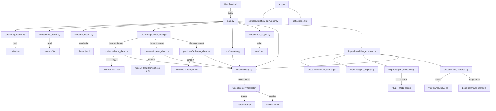

# Architecture

## Overview

KIO1 Orchestrator accepts natural-language requests — in a chat in the browser (`app.py`) or from a terminal (`main.py`) — produces structured JSON workflow plans, dispatches each plan step to the agent that carries it out, reads the results, and answers. It supports Ollama, OpenAI, Anthropic and OpenRouter through dynamically loaded provider modules. Optional OpenTelemetry instrumentation exports privacy-safe traces and metrics.

The KIOs it dispatches to are separate services. Until they all exist, `kio-mocks/` provides stand-ins that speak the same protocol and do a small version of each KIO's job; KIO1 does not import them, and they do not import KIO1.

## System Diagram

## Components

| Module | Responsibility |
|--------|---------------|
| `main.py` | Entry point; REPL loop, orchestrates all other modules |
| `core/config_loader.py` | Loads and validates `config.json` into a typed `Config` dataclass |
| `core/session_logger.py` | Per-session log file setup and duration measurement |
| `providers/provider_client.py` | Dynamically imports `<provider>_client.py` and validates it implements the required provider interface |
| `core/config_writer.py` | Saves registry changes back into `config.json`, replacing only `dispatch.agents` |
| `core/prompt_loader.py` | Reads the system prompt from disk and fills its `{{AGENT_CATALOG}}` placeholder from the registry |
| `providers/ollama_client.py` | Sends HTTP requests to the Ollama `/api/chat` endpoint |
| `providers/openai_client.py` | Sends requests via the OpenAI Chat Completions API |
| `providers/anthropic_client.py` | Sends requests via the Anthropic Messages API |
| `core/chat_history.py` | Manages JSONL-based conversation persistence |
| `core/formatter.py` | Pretty-prints JSON responses for terminal display |
| `core/telemetry.py` | Initializes OpenTelemetry, creates spans and metrics, records metadata, and flushes exporters |
| `dispatch/workflow_planner.py` | Validates a workflow plan and turns its steps into protocol execution messages |
| `dispatch/agent_registry.py` | Maps `agent_id` values from a plan to configured targets: KIO agents, REST APIs, and local commands |
| `dispatch/policy.py` | Gates: which capabilities may not run until others have passed, and the ordering they imply |
| `dispatch/failover.py` | Which targets can carry out a step, and in what order they are tried |
| `dispatch/scoreboard.py` | What each target has recently done, and the ranking that follows from it |
| `dispatch/discovery.py` | Fetches agent manifests and turns them into registry entries |
| `dispatch/directory.py` | The live set of targets: probes them, re-reads manifests on an interval, accepts registrations, and hands out fixed snapshots |
| `dispatch/tool_transport.py` | Adapts a REST API or a local command to the execution message and reply the executor reads |
| `dispatch/agent_transport.py` | Transport interface and the HTTP implementation |
| `dispatch/nats_transport.py` | NATS request/reply implementation of the same interface |
| `dispatch/transport_factory.py` | Routes each step to the transport its target's kind requires; `dispatch.transport` chooses only how KIO agents are reached |
| `dispatch/workflow_executor.py` | Runs a routed plan sequentially or in parallel and collects per-step results |
| `tools/dummy_agent.py` | Dependency-free stub agent used to validate the protocol end to end |
| `app.py` | The web service: the Workflow API's endpoints, the registry API, and the console. Started with `uvicorn app:app` |
| `services/workflow_api/runner.py` | Turns one request into a plan, dispatches it, and records the outcome |
| `static/` | The console: `index.html`, `app.css`, `app.js`. No build step and no external requests |
| `services/session_manager/` | Records sessions, steps, artifacts, and lineage in PostgreSQL |
| `core/session_client.py` | Client the Workflow API and terminal use to talk to the Session Manager |
| `core/service_telemetry.py` | Trace export and the server-span middleware shared by both services |

## Data Flow

1. A session ID is generated, logging is initialized, and configuration is loaded.
2. OpenTelemetry is initialized when `telemetry.enabled` is `true`.
3. The system prompt and configured provider are loaded, and the model is preloaded or validated inside the startup trace.
4. A new JSONL chat file is created and the session-started metric is recorded.
5. Each user request runs inside a turn trace containing the provider request and response-formatting spans.
6. Provider response metadata, token usage, workflow structure, and request durations are recorded without prompt or response content.
7. User and assistant messages are appended to the chat file after each exchange.
8. When `dispatch.enabled` is `true`, the plan is validated, routed against the agent registry, and its steps are delivered to the configured agents; results are printed as a per-step summary.
9. On exit, the session-completed metric is recorded and pending telemetry is flushed.

## Design Decisions

- **Standard-library Ollama client**: Ollama requests use `urllib.request`, avoiding an additional provider-specific HTTP dependency.
- **JSONL chat storage**: Each message is a single JSON line, enabling append-only writes and simple streaming reads.
- **Model preloading**: The model is loaded into Ollama memory at startup using configured `keep_alive` to reduce cold-start latency.
- **JSON-forced output**: The Ollama request includes `"format": "json"` to guarantee structured responses from the model.
- **Per-session logging**: Each run writes `logs/log_<session_id>.log` at `DEBUG`, paired with its `chats/chat_<session_id>.jsonl` by a shared id. Only `ERROR` reaches the console, keeping interactive output clean.
- **Message content at DEBUG only**: `INFO` records carry metadata (provider, model, durations, token counts); user queries and model responses appear only at `DEBUG`, which never reaches stderr.
- **Optional telemetry**: OpenTelemetry is disabled by default, allowing KIO1 to run without Docker or a Collector.
- **Optional dispatch**: Dispatch defaults to off in code, so KIO1 is usable as a plan-only tool; the shipped `config.json` turns it on. A plan step addressed to a target that is not configured is skipped, not failed.
- **Transport behind an interface**: The shared documents describe two different transports (direct HTTP in the KIO1-KIO10 protocol, NATS JetStream in the observability guide). `AgentTransport` isolates that choice from the planner and executor.
- **Dependency-free dispatch**: The HTTP transport and the stub agent use `urllib.request` and `http.server`, matching the existing Ollama client and adding no new runtime dependencies.
- **One message, two transports**: HTTP and NATS carry a byte-identical execution message. A test asserts the equality directly, so the two cannot drift apart.
- **Dependencies are optional and additive**: `depends_on` is validated defensively — malformed values, unknown references, and cycles are dropped with a warning rather than failing a plan that would otherwise run.
- **Results travel through the protocol's own extension point**: upstream outputs are passed in `data`, so feeding results forward adds no field to the agreed message shape.
- **One request, one trace**: both services continue the caller's trace rather than starting their own, so the path from an HTTP request through planning, dispatch, and every session write is a single tree. Span names use route templates so a session id never becomes a span name.
- **Traces from the services, metrics from the orchestrator**: the Session Manager exports traces under its own service name but no metrics, because the mandatory contract counters are keyed by `kio.id` and a second emitter would double-count them.
- **Two entry points, one core**: The terminal application and the Workflow API share configuration, prompt loading, planning, and dispatch. Only the way a request arrives differs.
- **Sessions opened before work starts**: `POST /workflow/run` refuses the request if no session can be opened, so a caller is never left holding no identifier for work that is already running.
- **Recording is best effort after that point**: losing a step record is not a reason to abandon a workflow that is already calling real agents, so only session creation is fatal.
- **Privacy-aware instrumentation**: Telemetry contains operational metadata but excludes prompts, responses, exception messages, and stack traces.
- **Persistent observability storage**: Collector queues, Tempo traces, and Prometheus metrics use named Docker volumes that survive container recreation.

