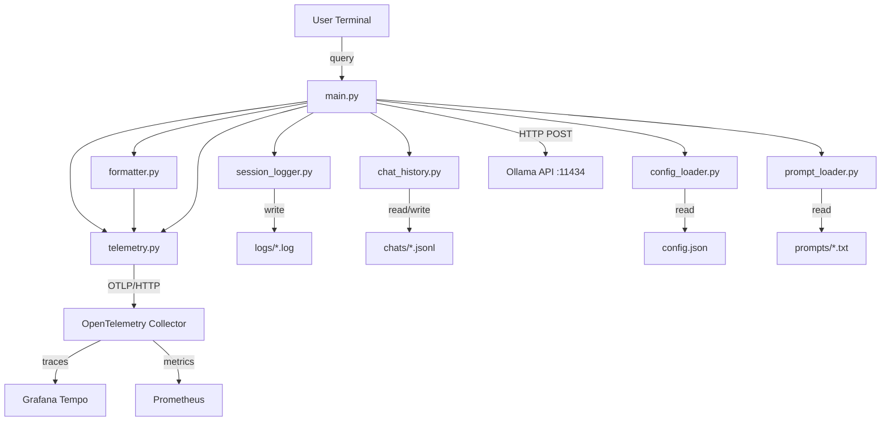

# Architecture

## Overview

KIO1 Orchestrator is a terminal application that sends natural-language user requests to a local Ollama model and prints the model's structured JSON reply. Optional OpenTelemetry instrumentation exports privacy-safe traces and metrics.

## System Diagram

## Components

| Module | Responsibility |
|--------|---------------|
| `main.py` | Entry point; REPL loop, Ollama request/response handling, orchestrates all other modules |
| `config_loader.py` | Loads and validates `config.json` into a typed `Config` dataclass |
| `session_logger.py` | Per-session log file setup and duration measurement |
| `prompt_loader.py` | Reads system prompt text from disk |
| `chat_history.py` | Manages JSONL-based conversation persistence |
| `formatter.py` | Pretty-prints JSON responses for terminal display |
| `telemetry.py` | Initializes OpenTelemetry, creates spans and metrics, records metadata, and flushes exporters |
| `observability/` | Defines the persistent Collector, Tempo, and Prometheus services |

## Data Flow

1. A session ID is generated, logging is initialized, and configuration is loaded.
2. OpenTelemetry is initialized when `telemetry.enabled` is `true`.
3. Inside the startup trace, the system prompt is loaded and Ollama preloads the model using the configured `keep_alive`.
4. A new JSONL chat file is created and the session-started metric is recorded.
5. For each user request, the REPL loads the prior messages, adds the new query, and sends the full conversation to Ollama inside a turn trace.
6. The response is formatted and printed as JSON unchanged, then the user and assistant messages are appended to the chat file. This is the end of the pipeline; the user can immediately type another query.
7. Throughout startup and each turn, telemetry records privacy-safe request metadata, token usage, durations, traces, and metrics without prompt or response content.
8. On exit, the session-completed metric is recorded and pending telemetry is flushed.

## Design Decisions

- **Standard-library Ollama client**: Ollama requests use `urllib.request`, avoiding an additional HTTP dependency.
- **JSONL chat storage**: Each message is a single JSON line, enabling append-only writes and simple streaming reads.
- **Model preloading**: The model is loaded into Ollama memory at startup using configured `keep_alive` to reduce cold-start latency.
- **JSON-forced output**: The Ollama request includes `"format": "json"` to guarantee structured responses from the model.
- **Per-session logging**: Each run writes `logs/log_<session_id>.log` at `DEBUG`, paired with its `chats/chat_<session_id>.jsonl` by a shared id. Only `ERROR` reaches the console, keeping interactive output clean.
- **Message content at DEBUG only**: `INFO` records carry metadata (model, durations, token counts); user queries and model responses appear only at `DEBUG`, which never reaches stderr.
- **Optional telemetry**: OpenTelemetry is disabled by default, allowing KIO1 to run without Docker or a Collector.
- **Privacy-aware instrumentation**: Telemetry contains operational metadata but excludes prompts, responses, exception messages, and stack traces.
- **Persistent observability storage**: Collector queues, Tempo traces, and Prometheus metrics use named Docker volumes that survive container recreation.

